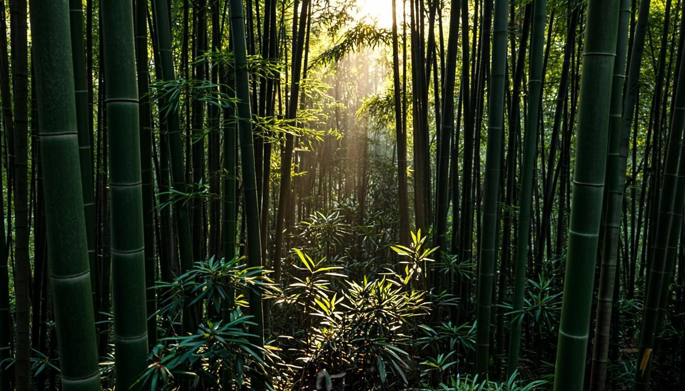

<div align="center">


# 🎋 BAMBU WATER NUSANTARA

### **Sejak 2007 • Terbesar & Pertama di Indonesia** 🇮🇩

**Situs resmi PT Bambu Water Nusantara — [bambuwater.web.id](https://bambuwater.web.id)**
*Air bambu terapi pengobatan alami & distribusi bambu berkualitas massal ke seluruh Indonesia*

<br>


<br>

**🇮🇩 Bahasa Indonesia** — [🇬🇧 English](#-english-documentation)

</div>

---



<br>

# 🇮🇩 DOKUMENTASI — BAHASA INDONESIA

## 📖 Tentang Proyek

Situs web korporat berstandar **internasional** untuk PT Bambu Water Nusantara — pionir & produsen terbesar **air bambu** (air sadapan bambu terapi pengobatan) sekaligus **distributor bambu berkualitas** massal (Petung, Wulung, Apus, Ori) di Indonesia. Dibangun dengan **Next.js 16 + React 19**, **25 halaman full-SEO**, **30 bahasa teratas dunia**, **animasi Framer Motion di setiap section**, dan **lapisan data terstruktur Schema.org 10 node per halaman**.

| Fakta | Nilai |
|---|---|
| 🏢 Badan usaha | PT Bambu Water Nusantara |
| 🌐 Domain resmi | **bambuwater.web.id** |
| 📅 Berdiri | **2007** — 18+ tahun (Terbesar & Pertama di Indonesia) |
| 💬 WhatsApp bisnis | **+62 813-1651-6524** (fixed, sitewide) |
| 📄 Halaman | **25 halaman full-SEO** (hash routing `#/slug`) |
| 🌍 Bahasa | **30 bahasa** — id (default) › en › zh › 27 lainnya |
| 🎬 Animasi | Framer Motion di 100% section + micro-interaction |
| 🧠 SEO teknis | JSON-LD 10 node, hreflang ×31, sitemap 25×30 URL |

---

## ✨ Fitur Unggulan

| 🏆 Fitur | Detail Implementasi |
|---|---|
| 🌍 **30 Bahasa Dunia** | id → en → zh dimuat **eager & lengkap (1.447 string)**; 27 bahasa lazy-loaded per chunk. Switcher Globe di navbar (prioritas di atas) + drawer mobile. Persist via hash `#/{locale}/{slug}` — SEO-friendly, shareable, tanpa reload. |
| 🔍 **SEO Maksimal** | Title/description/keywords/OG/Twitter/canonical **dinamis per halaman × per bahasa**, hreflang 30 locale + `x-default`, `og:locale:alternate`, sitemap 750 URL, robots.txt, meta geo ID-JB. |
| 🧠 **Data Terstruktur** | JSON-LD **10 node per halaman**: Corporation, WebSite, LocalBusiness, Person (entity layer), 3× Product/Offer, FAQPage, BreadcrumbList, 2× Organization pendukung — semua saling tertaut via `@id`. |
| ✨ **Full Animasi** | Reveal-on-scroll berjenjang, mega-menu spring, hero parallax, shimmer gold, counter angka, accordion fluid, drawer spring, micro-interaction hover di seluruh komponen — dengan **penghormatan penuh `prefers-reduced-motion`**. |
| 💧 **Konten Kesehatan** | 7 artikel edukatif (gula darah, batu ginjal, kolesterol, detoks, silika tulang, kecantikan, sejarah), 10 FAQ, kandungan nutrisi (silika 70%, flavonoid, polifenol) — berbasis riset sumber kredibel (PMC, TIME). |
| 📞 **Konversi WhatsApp** | Float button, CTA band, tombol di semua halaman, form quote → pesan WA ter-pra-isi + API kontak (Prisma + Zod). Nomor **+62 813-1651-6524** konsisten sitewide. |
| 🛡️ **Hydration-Proof** | Pola `useSyncExternalStore` di seluruh state eksternal (locale, route, reduced-motion, tahun berjalan). **0 hydration error** terverifikasi sweep 25/25 halaman. |
| 🎨 **Design System** | Palet hijau bambu + emas + krem, font Playfair Display + Plus Jakarta Sans, komponen shadcn/ui New York, dark-mode-ready (next-themes). |

---

## 🏗️ Arsitektur

```
┌─────────────────────────────────────────────────────────────────────┐
│                        🌐 bambuwater.web.id                          │
├─────────────────────────────────────────────────────────────────────┤
│  Next.js 16 (App Router, Turbopack) — SATU route "/" + hash router  │
│                                                                     │
│  ┌───────────────┐   ┌──────────────────┐   ┌────────────────────┐  │
│  │  I18nProvider │──▶│   AppShell       │──▶│  25 Page Components │  │
│  │  (30 locale)  │   │  useHashRoute    │   │  (18 statis + 7     │  │
│  │  id/en eager  │   │  SEO effect      │   │   artikel dinamis)  │  │
│  │  27 lazy      │   │  JSON-LD engine  │   └────────────────────┘  │
│  └───────────────┘   └──────────────────┘                           │
│         │                     │                                     │
│  ┌──────▼───────┐      ┌──────▼────────┐   ┌────────────────────┐  │
│  │ 30 dict JSON │      │ Navbar mega-  │   │ Footer + WA Float  │  │
│  │ (1.447 str)  │      │ menu + Globe  │   │ + LanguageSwitcher │  │
│  └──────────────┘      └───────────────┘   └────────────────────┘  │
│                                                                     │
│  API: POST /api/contact (Zod validasi + Prisma/SQLite)              │
└─────────────────────────────────────────────────────────────────────┘
```

**Routing hash locale-aware:**

```
#/                      → Beranda (Bahasa Indonesia — default)
#/faq                   → FAQ (id)
#/en/faq                → FAQ (English)
#/zh/kontak             → Kontak (中文)
#/ar/faq                → FAQ (العربية — RTL otomatis)
```

---

## 🔍 SEO Standar Internasional

| Lapisan | Implementasi |
|---|---|
| **Meta per halaman** | `title` (≤60 char), `description` (≤155 char), `keywords` — 25 halaman × 30 bahasa, ditulis via effect tanpa konflik RSC restore |
| **Canonical** | `https://bambuwater.web.id/#/{locale}/{slug}` — 1 kanonik per halaman per bahasa |
| **hreflang** | 30 locale + `x-default` = **31 link per halaman**, ditulis ulang per navigasi |
| **Open Graph** | `og:title/description/url/locale` + `og:locale:alternate` (en, zh, es, ar, ja, hi) + 2 og:image |
| **Twitter Card** | `summary_large_image` + title/description terjemahan |
| **JSON-LD** | Corporation, WebSite (+SearchAction), LocalBusiness (geo ID-JB), Person (entity layer), 3× Product/Offer (air suling, air tabib, bambu batang), FAQPage (10 Q&A sinkron konten), BreadcrumbList, 2× Organization pendukung |
| **Sitemap** | `sitemap.xml` — 25 halaman × 30 bahasa + alternates = **750+ URL terindeks** |
| **Entity Layer** | Knowledge-graph Person + Organization + 2 entitas pendukung tertaut `@id` — sameAs ke 6 profil sosial & 2 domain pendukung; author/creator/owner di meta sitewide |
| **Geo meta** | `geo.region=ID-JB`, placename Tasikmalaya, posisi koordinat + ICBM |
| **robots.txt** | Allow all + sitemap URL |

---

## 🌍 i18n — 30 Bahasa Teratas Dunia

**Prioritas:** 🥇 **Bahasa Indonesia** (default & sumber kebenaran) → 🥈 **English** (lengkap penuh) → 🥉 **中文 Mandarin** (lengkap penuh) → 27 bahasa dunia lainnya.

| # | Bahasa | Kode | Cakupan | # | Bahasa | Kode | Cakupan |
|---|---|---|---|---|---|---|---|
| 1 | 🇮🇩 Indonesia | `id` | ⭐ FULL | 16 | 🇰🇷 Korea | `ko` | ui+meta |
| 2 | 🇬🇧 English | `en` | ⭐ FULL | 17 | 🇮🇹 Italia | `it` | ui+meta |
| 3 | 🇨🇳 中文 | `zh` | ⭐ FULL | 18 | 🇹🇭 Thai | `th` | ui+meta |
| 4 | 🇮🇳 Hindi | `hi` | ui+meta | 19 | 🇮🇷 Farsi | `fa` | ui+meta RTL |
| 5 | 🇪🇸 Spanyol | `es` | ui+meta | 20 | 🇵🇱 Polandia | `pl` | ui+meta |
| 6 | 🇫🇷 Prancis | `fr` | ui+meta | 21 | 🇳🇱 Belanda | `nl` | ui+meta |
| 7 | 🇸🇦 Arab | `ar` | ui+meta RTL | 22 | 🇺🇦 Ukraina | `uk` | ui+meta |
| 8 | 🇧🇩 Bengali | `bn` | ui+meta | 23 | 🇲🇲 Burma | `my` | ui+meta |
| 9 | 🇧🇷 Portugis | `pt` | ui+meta | 24 | 🇰🇪 Swahili | `sw` | ui+meta |
| 10 | 🇷🇺 Rusia | `ru` | ui+meta | 25 | 🇵🇭 Filipino | `fil` | ui+meta |
| 11 | 🇵🇰 Urdu | `ur` | ui+meta RTL | 26 | 🇲🇾 Melayu | `ms` | ui+meta |
| 12 | 🇩🇪 Jerman | `de` | ui+meta | 27 | 🇮🇱 Ibrani | `he` | ui+meta RTL |
| 13 | 🇯🇵 Jepang | `ja` | ui+meta | 14 | 🇮🇳 Marathi | `mr` | ui+meta |
| 14 | 🇹🇷 Turki | `tr` | ui+meta | 15 | 🇮🇳 Telugu | `te` | ui+meta |
| — | 🇻🇳 Vietnam | `vi` | ui+meta | — | 🇮🇳 Tamil | `ta` | ui+meta |

> **FULL** = ui + meta SEO + body halaman + data terstruktur (1.447 string). **ui+meta** = kerangka UI + meta SEO (konten body fallback otomatis ke English). RTL otomatis (`dir="rtl"`) untuk arab, urdu, farsi, ibrani.

**Pipeline terjemahan:** `scripts/i18n-translate.ts` — flatten → batch 45 string → LLM → validasi key → retry 429 → resume dari partial. `scripts/i18n-compile.ts` — merge fragmen `.id.json` + PAGES_META → `compiled/id.json`.

---

## ✨ Inventaris Animasi

| Komponen | Animasi |
|---|---|
| Hero beranda | Fade-slide berjenjang, badge shimmer emas, float CTA |
| Reveal system | `Reveal` / `StaggerContainer` / `StaggerItem` — scroll-trigger berjenjang di semua section |
| Mega-menu | Spring layout pill aktif (`layoutId`), dropdown scale+fade, stagger anak menu |
| Halaman | Page transition fade+slide (key `locale\|slug`), PageHero parallax lembut |
| Stats strip | Counter angka naik, hover glow |
| FAQ | Accordion radix height fluid + chevron rotate |
| Drawer mobile | Spring slide-in + backdrop blur |
| Language switcher | Dropdown animasi, check aktif, hover state |
| WhatsApp float | Pulse lembut, hover scale |
| Card produk/harga | Hover lift + shadow bloom |
| ⛔ Aksesibilitas | Semua animasi otomatis mati saat `prefers-reduced-motion` (hook kustom, aman hidrasi) |

---

## 🗺️ Peta Situs — 25 Halaman Full-SEO

| Grup Navigasi | Halaman |
|---|---|
| **Beranda** | `beranda` |
| **Kesehatan** | `apa-itu-air-bambu` • `manfaat-air-bambu` • `kandungan-nutrisi` • `air-bambu-pengobatan` • `sejarah-air-bambu` |
| **Artikel Kesehatan** | `air-bambu-gula-darah` • `air-bambu-batu-ginjal` • `air-bambu-kolesterol` • `air-bambu-detoksifikasi` • `air-bambu-tulang-silika` • `air-bambu-kecantikan` |
| **Produk** | `air-bambu-suling` • `air-bambu-tabib` • `bambu-berkualitas` |
| **Layanan** | `proses-produksi` • `pengiriman-massal` • `jangkauan-kota` • `harga-paket` • `cara-pemesanan` |
| **Informasi** | `tentang-kami` • `artikel` • `testimoni` • `faq` • `kontak` |

---

## 💼 Bisnis & Kontak

| | |
|---|---|
| 📱 **WhatsApp (fixed)** | **+62 813-1651-6524** — [wa.me/6281316516524](https://wa.me/6281316516524) |
| 🏭 **Produk unggulan** | Air bambu suling (600 ml/1,5 L/galon 19 L/jerigen/drum) • Air bambu tabib sadapan segar • Bambu batang Petung, Wulung, Apus, Ori |
| 🚚 **Pengiriman** | Massal antar-pulau seluruh Indonesia — kota besar → daerah (tiered) |
| 🏢 **Legalitas** | Akta pendirian tercatat — Komisaris Utama Hj. Qonitah Lutfiah, S.E., M.M. • Direktur Utama H. Gugun Gunara, S.E. |
| 📜 **Klaim merek** | **Sejak 2007 • Terbesar & Pertama di Indonesia** |

---

## 🚀 Mulai Cepat

```bash
# Install
bun install

# Dev server (http://localhost:3000)
bun run dev

# Lint
bun run lint

# Database (Prisma + SQLite)
bun run db:push

# i18n — compile dictionary id dari fragmen
bun run scripts/i18n-compile.ts

# i18n — terjemahkan ke 29 bahasa (resume-able, retry 429 otomatis)
bun run scripts/i18n-translate.ts            # semua bahasa
bun run scripts/i18n-translate.ts ja ko      # bahasa tertentu
```

---

## 📁 Struktur Proyek

```
src/
├── app/
│   ├── layout.tsx            # Metadata global + entity meta + font
│   ├── page.tsx              # Entry → AppShell
│   ├── sitemap.ts            # 25×30 URL + alternates
│   ├── robots.ts
│   └── api/contact/route.ts  # POST (Zod + Prisma)
├── components/
│   ├── app/app-shell.tsx     # Router + SEO engine + JSON-LD
│   ├── pages/                # 20 komponen halaman
│   └── site/                 # navbar, footer, hero, language-switcher, json-ld, dst.
├── hooks/
│   ├── use-hash-route.ts     # Router hash locale-aware (useSyncExternalStore)
│   ├── use-current-year.ts   # Tahun berjalan aman hidrasi
│   └── use-prefers-reduced-motion.ts
└── lib/
    ├── company.ts            # Data bisnis, FAQ, harga, tier kirim
    ├── pages-registry.ts     # PAGES_META 25 halaman + NAV_GROUPS
    ├── branding.ts           # Entity layer (Person + support systems)
    ├── articles.ts           # 7 artikel
    └── i18n/
        ├── config.ts         # 30 locale + parser hash + RTL
        ├── context.tsx       # I18nProvider + loader lazy
        └── dictionaries/
            ├── compiled/     # 30 locale siap pakai (id/en/zh FULL)
            ├── parts/ pages/ data/   # fragmen sumber id
            └── tmp/          # progress partial pipeline
```

---

## 🛡️ Pola Engineering — Hidrasi Aman (God Mode)

Situs ini **nol toleransi** terhadap hydration mismatch. Pola yang dipakai:

1. **`useSyncExternalStore` untuk SEMUA state eksternal** — locale, hash route, reduced-motion, tahun berjalan. `getServerSnapshot` **wajib** mengembalikan nilai yang identik dengan output SSR; nilai klien menyusul setelah hidrasi.
2. **`new Date()` dilarang di render** — gunakan `useCurrentYear()` (+ `suppressHydrationWarning` pada node teks tahun).
3. **Tulis file JSON dalam src/ secara atomik** — script pipeline memakai `writeAtomic()` (tmp + rename) dan menyimpan partial di luar `src/` (`.i18n-cache/`) agar Turbopack watcher tidak pernah melihat JSON setengah jadi (sumber klasik full-reload dev).
4. **Framer motion reduced-motion via hook kustom** — bukan `useReducedMotion` bawaan yang membaca `matchMedia` sinkron saat render pertama.

---

<div align="center">


### 📞 Konsultasi & Pemesanan

**WhatsApp +62 813-1651-6524** — Gratis konsultasi • Respons cepat • Kirim seluruh Indonesia

*© 2026 PT Bambu Water Nusantara • bambuwater.web.id — Sejak 2007, Terbesar & Pertama di Indonesia*

</div>

---
---

<div align="center">

# 🇬🇧 ENGLISH DOCUMENTATION

### **Since 2007 • The Largest & First in Indonesia** 🇮🇩

**Official website of PT Bambu Water Nusantara — [bambuwater.web.id](https://bambuwater.web.id)**
*Therapeutic bamboo water & bulk premium bamboo distribution across Indonesia*

**[🇮🇩 Kembali ke Bahasa Indonesia](#-dokumentasi--bahasa-indonesia)**

</div>

---

## 📖 About

An **international-standard** corporate website for PT Bambu Water Nusantara — the pioneer and largest producer of **bamboo water** (therapeutic bamboo sap) and **bulk distributor of premium bamboo** (Petung, Wulung, Apus, Ori) in Indonesia. Built on **Next.js 16 + React 19** with **25 full-SEO pages**, **30 world languages**, **Framer Motion animations in every section**, and a **10-node Schema.org structured-data layer on every page**.

| Fact | Value |
|---|---|
| 🏢 Company | PT Bambu Water Nusantara |
| 🌐 Official domain | **bambuwater.web.id** |
| 📅 Founded | **2007** — 18+ years (Largest & First in Indonesia) |
| 💬 Business WhatsApp | **+62 813-1651-6524** (fixed, sitewide) |
| 📄 Pages | **25 full-SEO pages** (hash routing `#/slug`) |
| 🌍 Languages | **30 languages** — id (default) › en › zh › 27 more |
| 🎬 Animation | Framer Motion in 100% of sections + micro-interactions |
| 🧠 Technical SEO | 10-node JSON-LD, hreflang ×31, sitemap 25×30 URLs |

---

## ✨ Feature Highlights

| 🏆 Feature | Implementation Detail |
|---|---|
| 🌍 **30 World Languages** | id → en → zh loaded **eager & complete (1,447 strings)**; 27 others lazy-loaded per chunk. Globe switcher in navbar (priority group on top) + mobile drawer. Persisted via `#/{locale}/{slug}` hash — SEO-friendly, shareable, no reload. |
| 🔍 **Maximum SEO** | Dynamic title/description/keywords/OG/Twitter/canonical **per page × per language**, hreflang 30 locales + `x-default`, `og:locale:alternate`, 750-URL sitemap, robots.txt, geo meta ID-JB. |
| 🧠 **Structured Data** | JSON-LD **10 nodes per page**: Corporation, WebSite, LocalBusiness, Person (entity layer), 3× Product/Offer, FAQPage, BreadcrumbList, 2× supporting Organizations — all interlinked via `@id`. |
| ✨ **Full Animation** | Staggered scroll reveals, spring mega-menu, hero parallax, gold shimmer, count-up numbers, fluid accordions, spring drawer, hover micro-interactions everywhere — with **full `prefers-reduced-motion` respect**. |
| 💧 **Health Content** | 7 educational articles (blood sugar, kidney stones, cholesterol, detox, bone silica, beauty, history), 10 FAQs, nutrition breakdown (70% organic silica, flavonoids, polyphenols) — researched from credible sources (PMC, TIME). |
| 📞 **WhatsApp Conversion** | Float button, CTA band, buttons on every page, quote form → pre-filled WA message + contact API (Prisma + Zod). **+62 813-1651-6524** consistent sitewide. |
| 🛡️ **Hydration-Proof** | `useSyncExternalStore` pattern for all external state (locale, route, reduced-motion, current year). **0 hydration errors** verified by a 25/25-page sweep. |
| 🎨 **Design System** | Bamboo green + gold + cream palette, Playfair Display + Plus Jakarta Sans, shadcn/ui New York components, dark-mode-ready (next-themes). |

---

## 🔍 International-Standard SEO

| Layer | Implementation |
|---|---|
| **Per-page meta** | `title` (≤60 chars), `description` (≤155 chars), `keywords` — 25 pages × 30 languages, written via effects without RSC-restore conflicts |
| **Canonical** | `https://bambuwater.web.id/#/{locale}/{slug}` — one canonical per page per language |
| **hreflang** | 30 locales + `x-default` = **31 links per page**, rewritten on every navigation |
| **Open Graph** | `og:title/description/url/locale` + `og:locale:alternate` (en, zh, es, ar, ja, hi) + 2 og:image |
| **Twitter Card** | `summary_large_image` + translated title/description |
| **JSON-LD** | Corporation, WebSite (+SearchAction), LocalBusiness (geo ID-JB), Person (entity layer), 3× Product/Offer (distilled water, healer water, bamboo poles), FAQPage (10 Q&As synced to content), BreadcrumbList, 2× supporting Organizations |
| **Sitemap** | `sitemap.xml` — 25 pages × 30 languages + alternates = **750+ indexed URLs** |
| **Entity Layer** | Knowledge-graph Person + Organization + 2 supporting entities linked via `@id` — sameAs to 6 social profiles & 2 supporting domains; author/creator/owner sitewide meta |
| **Geo meta** | `geo.region=ID-JB`, placename Tasikmalaya, coordinates + ICBM |
| **robots.txt** | Allow all + sitemap URL |

---

## 🌍 i18n — 30 Top World Languages

**Priority:** 🥇 **Bahasa Indonesia** (default & source of truth) → 🥈 **English** (fully complete) → 🥉 **中文 Mandarin** (fully complete) → 27 other world languages.

> **FULL** = ui + SEO meta + page body + structured data (1,447 strings). **ui+meta** = UI shell + SEO meta (page body automatically falls back to English). Auto-RTL (`dir="rtl"`) for Arabic, Urdu, Farsi, Hebrew.

**Translation pipeline:** `scripts/i18n-translate.ts` — flatten → 45-string batches → LLM → key validation → 429 retry → resumable partials. `scripts/i18n-compile.ts` — merges `.id.json` fragments + PAGES_META → `compiled/id.json`.

---

## 🗺️ Site Map — 25 Full-SEO Pages

| Nav Group | Pages |
|---|---|
| **Home** | `beranda` |
| **Health** | what is bamboo water • benefits • nutrition content • for therapy • history |
| **Health Articles** | blood sugar • kidney stones • cholesterol • detox • bone silica • beauty |
| **Products** | distilled bamboo water • healer bamboo water • premium bamboo |
| **Services** | production process • bulk delivery • city coverage • pricing • how to order |
| **Information** | about us • articles • testimonials • FAQ • contact |

---

## 💼 Business & Contact

| | |
|---|---|
| 📱 **WhatsApp (fixed)** | **+62 813-1651-6524** — [wa.me/6281316516524](https://wa.me/6281316516524) |
| 🏭 **Flagship products** | Distilled bamboo water (600 ml / 1.5 L / 19 L gallon / jerry can / drum) • Fresh-sap healer water • Bamboo poles: Petung, Wulung, Apus, Ori |
| 🚚 **Delivery** | Bulk inter-island shipping across Indonesia — tiered by region |
| 📜 **Brand claim** | **Since 2007 • Largest & First in Indonesia** |

---

## 🚀 Quick Start

```bash
# Install
bun install

# Dev server (http://localhost:3000)
bun run dev

# Lint
bun run lint

# Database (Prisma + SQLite)
bun run db:push

# i18n — compile the id dictionary from fragments
bun run scripts/i18n-compile.ts

# i18n — translate into 29 languages (resumable, auto 429 retry)
bun run scripts/i18n-translate.ts            # all languages
bun run scripts/i18n-translate.ts ja ko      # specific languages
```

---

## 🛡️ Engineering Patterns — Hydration-Safe (God Mode)

This site has **zero tolerance** for hydration mismatches:

1. **`useSyncExternalStore` for ALL external state** — locale, hash route, reduced-motion, current year. `getServerSnapshot` **must** return a value identical to the SSR output; the client value follows after hydration.
2. **`new Date()` is banned in render** — use `useCurrentYear()` (+ `suppressHydrationWarning` on year text nodes).
3. **Atomic writes for JSON inside `src/`** — pipeline scripts use `writeAtomic()` (tmp + rename) and keep partials outside `src/` (`.i18n-cache/`) so the Turbopack watcher never sees half-written JSON (a classic dev full-reload source).
4. **Framer Motion reduced-motion via custom hook** — not the built-in `useReducedMotion` that reads `matchMedia` synchronously during first render.

---

<div align="center">

**🎋 Bambu Water Nusantara** — *Therapeutic Bamboo Water & Premium Bamboo, Delivered Nationwide*

[🌐 bambuwater.web.id](https://bambuwater.web.id) • [💬 WhatsApp +62 813-1651-6524](https://wa.me/6281316516524)

**Since 2007 • The Largest & First in Indonesia** 🇮🇩

</div>
